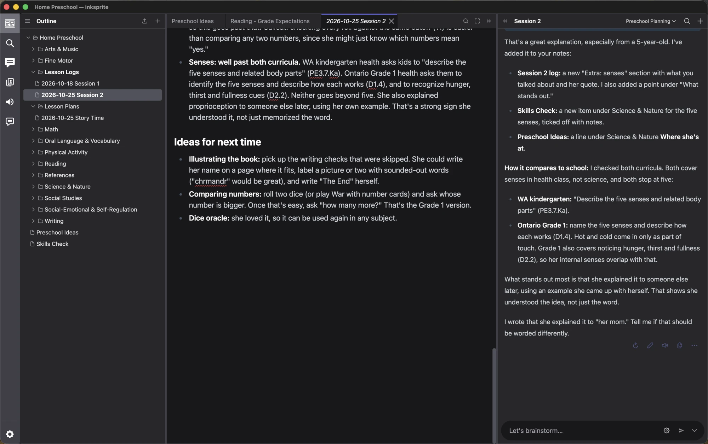

# inksprite

inksprite is a privacy-focused research and writing app with a powerful suite of built-in AI tools.

Some of the ways people use inksprite:

- **Technical research and writing:**
  - Write research papers and technical design documents
  - Summarize and ask questions about books, papers, and source code
  - Integrate with internal MCP tooling and model providers
- **Creative writing and worldbuilding:**
  - Brainstorm about your world and characters
  - Play D&D by yourself
  - Write ~~terrible fanfiction~~ your magnum opus
- **Education and learning:**
  - Plan homeschool lessons and track your child’s progress
  - Ask questions about lecture notes, book chapters, and research papers
  - Create audio podcast summaries from your study material



## Getting Started

**Web app:** No account or sign-in needed. Just go to [app.inksprite.io](https://app.inksprite.io) and start writing.

**Desktop:** The desktop app has [a few extra features](https://docs.inksprite.io/desktop#what-only-the-desktop-app-does), and is available for Mac, Linux, and Windows. Grab the [latest release](https://github.com/inksprite-io/inksprite/releases/latest) for your platform.

**Mobile:** We don’t ship a dedicated app for Android or iOS (yet), but you can [install it as a browser app](https://docs.inksprite.io/getting-started#install-it-from-your-browser).

Check out the [user guide](https://docs.inksprite.io/) if you need help getting started.

## Philosophy

**Local-first:** inksprite runs on your device and works without an internet connection. All of the default tooling is tuned to work well with popular local models.

**Privacy-first:** None of your data leaves your device unless you choose to enable cloud sync or connect to a third-party service. Your data is stored in your browser when using the web app, or on your local file system when using the desktop app.

**Open source:** inksprite is open source. We built it both for ourselves and to share it with others.

## Features

**AI writing and editing tools:** The built-in AI tools can help you [write and edit your work](https://docs.inksprite.io/research#write-the-draft), [give you critical feedback](https://docs.inksprite.io/research#ask-for-a-review), take notes, brainstorm, or plan your project.

**Research tools:** The AI can [search the web](https://docs.inksprite.io/web-search), [extract text from PDFs](https://docs.inksprite.io/files), [summarize large bodies of work](https://docs.inksprite.io/research#summarize-them), and answer questions about complex topics. In the desktop app, it can also [analyze data and run experiments](https://docs.inksprite.io/data-analysis) in an isolated Python sandbox.

**MCP servers and skills:** You can extend inksprite by connecting to [MCP servers](https://docs.inksprite.io/mcp) and adding [custom skills](https://docs.inksprite.io/skills).

**Provider support:** We provide out-of-the-box integrations with OpenRouter, Anthropic, OpenAI, and various local endpoints. inksprite will work with any OpenAI-compatible provider. If you find a provider that doesn’t work, let us know by [opening an issue](https://github.com/inksprite-io/inksprite/issues).

**Encrypted cloud sync:** You can **optionally** back up your work to the cloud, which allows you to [access it from any device](https://docs.inksprite.io/sync) and [collaborate with other inksprite users](https://docs.inksprite.io/sync#share-a-project). You hold the encryption keys, which means that we cannot access your work even if we wanted to (we don’t). **Cloud sync is currently invite-only. Email us at [sync@inksprite.io](mailto:sync@inksprite.io) if you want an invite.**

**Sync to and from Google Docs:** Need to share a design doc with your team but want to do your research and writing in inksprite? You can [link a document to a Google Doc](https://docs.inksprite.io/google-docs), which allows you to share your work, respond to comments and suggestions, and synchronize changes with Google Drive.

**Roleplaying games:** inksprite started out as a tool for running solo tabletop RPGs. Use the built-in RPG tools to play solo, plan and run tabletop games for your friends, or [chat with character cards](https://docs.inksprite.io/roleplay) from popular bot sites.

**Audio narration:** Use inksprite’s text-to-speech [narration tools](https://docs.inksprite.io/narration) to create an educational podcast series for your kids, turn your novel into an audiobook, or create an easy-to-digest podcast summary of your dissertation.

## Building and Running Locally

This builds and runs the provided Docker Compose file, which starts dev servers for the web app at <http://localhost:8002> and the docs site at <http://localhost:4321>.

```sh
docker compose up -d
```

The dev servers will hot reload as you make changes. If the app’s dependencies change, rebuild it by running `./rebuild-test-server.sh`.

### Desktop App

You can run the desktop app on Mac using this script:

```sh
./app/electron/start-on-mac.sh
```

On Linux, run `npm start` in `app/electron` instead. Running on Windows is left as an exercise for the reader. Send us a pull request with your script if you try it 🙏.

See the desktop app [README](app/electron/README.md) for more details.

## Contributing

[Feedback](https://github.com/inksprite-io/inksprite/discussions), [bug reports](https://github.com/inksprite-io/inksprite/issues), and [patches](https://github.com/inksprite-io/inksprite/pulls) are welcome. See [CONTRIBUTING.md](CONTRIBUTING.md).

## License

inksprite is licensed under the [GNU General Public License, version 3 or later](LICENSE). All rights to the inksprite name and logo are reserved. See [CREDITS.md](CREDITS.md) for a list of third-party resources not covered by this license.
