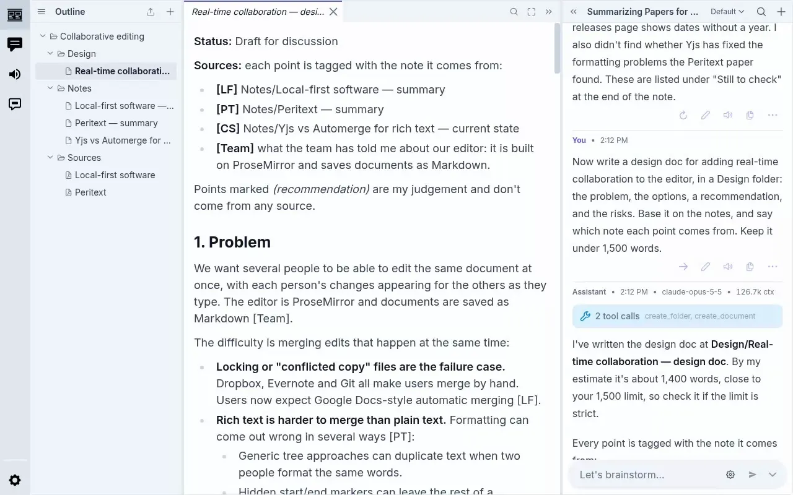
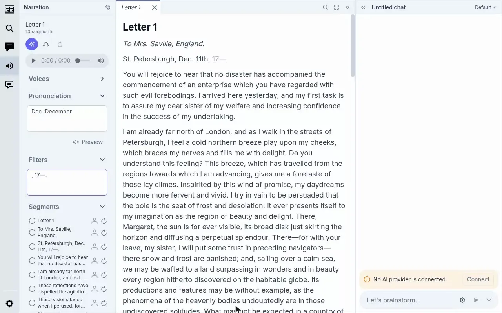
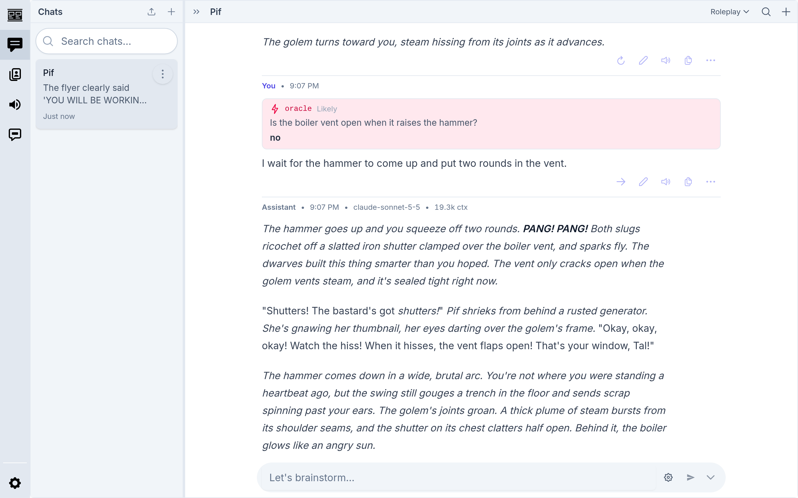

# inksprite

inksprite is a writing app that runs locally in your browser or as a standalone
desktop application. You do not need to make an account to use inksprite. Your
work stays on your device.

<picture>
  <source media="(prefers-color-scheme: dark)" srcset="docs/src/assets/guide/first-chat-dark.png">
  
</picture>

**[Open it in your browser](https://app.inksprite.io)** ·
[Download the desktop app](https://github.com/inksprite-io/inksprite/releases/latest) ·
[Getting Started guide](https://docs.inksprite.io/getting-started)

## AI tools

You can use the built-in AI tools to:

- Write and edit documents
- Research and brainstorm
- Generate audio narrations

They work with OpenRouter, Anthropic, OpenAI, or a model on your own machine.
Requests go straight from your device to the provider.

inksprite is still in development. Please report bugs and issues
[here](https://github.com/inksprite-io/inksprite/issues).

## Examples

### Research

The model summarizes the papers you import, searches the web, and writes a
design doc from what it found. You comment on the draft as you would on a
colleague's, and the model works through the comments.
[The research guide](https://docs.inksprite.io/research) follows it from
start to finish.

<picture>
  <source media="(prefers-color-scheme: dark)" srcset="docs/readme/research-comment-dark.webp">
  
</picture>

### Narration

inksprite reads your documents aloud in the voices you choose, with Kokoro on
your own computer or a voice from OpenAI or OpenRouter, and you can download
the audio. [The narration guide](https://docs.inksprite.io/narration) reads
the first letter of *Frankenstein*, and you can listen to it there.

<picture>
  <source media="(prefers-color-scheme: dark)" srcset="docs/readme/narration-generate-dark.webp">
  
</picture>

### Roleplay

Import a character card and its lorebook, play your own character, and the
model plays everyone else. You steer the story with dice, the oracle and
out-of-character notes. [The roleplay guide](https://docs.inksprite.io/roleplay)
plays one through.

<picture>
  <source media="(prefers-color-scheme: dark)" srcset="docs/src/assets/guide/roleplay-oracle-dark.png">
  
</picture>

## Running it

```bash
cd app
npm install
npm run dev
```

`npm run build` writes a static site to `app/dist/`. A build sends no
analytics unless it is built with `VITE_VERCEL_ANALYTICS=true`. Its service
worker keeps the app's files, so that it opens offline and installs; should
that ever have to go from browsers that have it, build with
`VITE_REMOVE_SERVICE_WORKER=true` (`app/sw-remove.js`).

## Contributing

[CONTRIBUTING.md](CONTRIBUTING.md) has the setup, the sign-off rule, and the
terms a contribution comes in under: you keep your copyright and license it
under Apache-2.0, and the project releases the whole under the GPL. Read that
section before your first pull request.

## License

inksprite is free software under the
[GNU General Public License, version 3 or later](LICENSE).
Copyright © 2025–2026 The inksprite Authors.

### Icons

The icons are from the [Noun Project](https://thenounproject.com), each
under [CC BY 3.0](https://creativecommons.org/licenses/by/3.0/) by its
creator, and are not covered by the GPL. [CREDITS.md](CREDITS.md) lists
them, and the app credits them under Settings › About.

### The name and the logo

The inksprite name and the logo are not covered by the license; all rights to
them are reserved.
